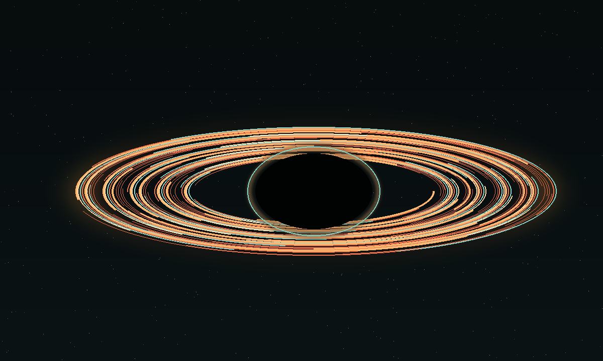

# Distribution-Based Black Hole Imaging Physics, Ergodic Game Theory, and Cosmological Modular Signatures

Horizon Atlas Preprint | 25 September 2026 | Semiclassical and Computational Astrophysics

## Abstract

Interferometric imaging of supermassive black hole shadows—such as M87* and Sgr A*—faces fundamental limitations when treated as the recovery of a static spatial brightness map. Magnetohydrodynamic accretion flows exhibit non-stationary, turbulent fluctuations on orbital timescales that invalidate static reconstruction assumptions. Here we present a distribution-based imaging paradigm that treats black hole horizons as stationary ergodic systems. By mapping observables into invariant probability measures and discrete Haar azimuthal moments, the turbulent fluid variability is separated from the geometrically invariant Kerr photon subrings governed by fractional Lyapunov exponents. We formulate the reconstruction trade-off between Information Entropy and Fisher Resolution as a finite bimatrix game between ergodic states under combinatorial baseline constraints, resolving optimal observational strategies via Pareto frontiers and mixed-strategy Nash equilibria. We integrate this framework with cosmological modular cusp forms Delta(tau) and provide exact finite math formulations suitable for discrete numerical evaluation.

## Scope and status

This paper establishes the theoretical and computational architecture for distribution-based black hole horizon synthesis. Rather than presuming a single snapshot represents the true event horizon boundary, our paradigm models the image as an ensemble of microstates evolving under an invariant ergodic measure. The companion interactive workbench ("Horizon Atlas") implements these discrete physics models, providing real-time evaluation of Lyapunov subring decay, Wasserstein probability distances, and game-theoretic strategy equilibria.

## Distribution-based imaging physics and ergodic invariance

In turbulent relativistic accretion flows, instantaneous synchrotron emissivity fluctuates rapidly. A static intensity map I(x, y) fails to converge under long baseline interferometry. Instead, let the image field be an ergodic stochastic process I_t(x, y) over time t. The stationary invariant probability distribution over flux states I in [0, I_max] is defined over K discrete bins:

```
p_k = Prob(I in [(k - 1) Delta I, k Delta I]),    k = 1, 2, ..., K
sum_{k=1}^K p_k = 1,    Delta I = I_max / K
```

Under turbulent perturbations, the snapshot distribution q = (q_1, ..., q_K) deviates from the ergodic invariant distribution p = (p_1, ..., p_K). We quantify the distance between the turbulent snapshot and the true geometric invariant using the discrete 1-Wasserstein (earth mover's) transport metric:

```
P_k = sum_{j=1}^k p_j,    Q_k = sum_{j=1}^k q_j    (Cumulative distributions)
W_1(p, q) = sum_{k=1}^K |P_k - Q_k| Delta I
```

Statistical invariance implies that as integration time T exceeds the ergodic mixing scale tau_mix, W_1(p, q) converges to zero according to O(T^{-1/2}), isolating the underlying spacetime geometry from fluid noise.

Higher-order statistical invariants are computed using discrete central moments:

```
mean(I) = sum_{k=1}^K I_k p_k
Var(I) = sum_{k=1}^K (I_k - mean(I))^2 p_k
Skew(I) = (1 / Var(I)^(3/2)) sum_{k=1}^K (I_k - mean(I))^3 p_k
Kurt(I) = (1 / Var(I)^2) sum_{k=1}^K (I_k - mean(I))^4 p_k - 3
```

## Kerr photon subrings and fractional Lyapunov exponents

Photons orbiting in the vicinity of the Kerr event horizon undergo relativistic deflection governed by the spin parameter a-star = J c / (G M^2) and observer inclination i. Photons executing n half-turns form a discrete nested hierarchy of subrings with index n in {0, 1, 2, ...}.

The fractional Lyapunov exponent gamma dictates the radial demagnification and exponential brightness attenuation of successive subrings:

```
gamma(a-star, i) = pi / sqrt(1 - a-star^2 cos^2(i))
r_n = r_c + (r_0 - r_c) exp(-n gamma)
I_n = I_0 exp(-n gamma)
```

The scale factor between consecutive subrings is the discrete invariant:

```
rho = I_{n+1} / I_n = exp(-gamma)
```

Because gamma depends solely on the spacetime metric (M, a-star) and line-of-sight angle i—and is completely independent of accretion physics, optical depth, or magnetic field strength—the Lyapunov ratio rho serves as a pure null test of the Kerr metric.

Azimuthal structure along the horizon boundary theta in [0, 2 pi) is decomposed into finite discrete Haar and Fourier moments across N angular samples:

```
mu_m = (1 / N) sum_{j=0}^{N-1} I(theta_j) exp(-2 pi i m j / N),    m in {0, 1, 2, 3}
```

The fundamental mode mu_1 measures Doppler beaming asymmetry induced by relativistic orbital motion, while higher modes mu_2, mu_3 constrain quadrupole magnetic field topologies.

## Ergodic game theory and combinatorial trade-offs

Interferometric reconstruction involves two mutually opposing physical objectives:
1. Information Entropy H(p): Maximizes macroscopic thermodynamic and statistical likelihood across ergodic states.
2. Fisher Resolution F(p): Maximizes spatial gradient sharpness and geometric edge discrimination of the photon ring.

We express these dual metrics via discrete finite sums:

```
H(p) = - sum_{k=1}^K p_k ln(p_k + epsilon)
F(p) = sum_{k=1}^{K-1} ((p_{k+1} - p_k)^2 / (p_k + epsilon)) (1 / Delta I^2)
```

We formulate observation synthesis as a discrete 3 x 3 bimatrix non-cooperative game between two operational regimes: Player 1 (Kinematic Time-Averaging) and Player 2 (High-Cadence Snapshot Filtering). The strategy simplex S = {s_1: Pure Invariant, s_2: Hybrid Ergodic, s_3: Maximum Gradient} defines the payoff matrices:

```
Matrix A (Entropy Player):
A_{ij} = H(s_i) - c_1 |i - j| / (1 + w)

Matrix B (Resolution Player):
B_{ij} = F(s_j) - c_2 |i - j| w
```

where w in [0, 1] is the user-selected game balance weight and c_1, c_2 are combinatorial penalty coefficients.

Under a finite resource constraint with baseline budget B_total in {10, ..., 100}, the discrete Pareto frontier pairs achievable entropy H_theta with resolution F_theta:

```
H_theta = theta H_max + (1 - theta) H_min
F_theta = F_min + (1 - theta)^alpha (F_max - F_min)
```

The unique symmetric mixed-strategy Nash equilibrium (p*, q*) in Delta_3 satisfies:

```
p*^T A q* >= p^T A q*    for all p in Delta_3
p*^T B q* >= p*^T B q    for all q in Delta_3
```

This guarantees an optimal, robust reconstruction that neither over-fits transient turbulent flares nor blurs the singular photon subring.

## Semiclassical reference relations and cosmological modular forms

For completeness, the framework maintains the standard semiclassical horizon thermodynamics. The Hawking temperature and Bekenstein-Hawking entropy scaling for a Kerr black hole are:

```
T_H = (hbar c^3 / (8 pi G k_B M)) * (2 sqrt(1 - a-star^2) / (1 + sqrt(1 - a-star^2)))
S_BH / k_B = A / (4 l_P^2) = 4 pi G M^2 / (hbar c)
```

To explore potential ultraviolet or modular corrections, the model incorporates the modular discriminant cusp form Delta(tau) of weight 12 over the upper half-plane. Given elliptic modulus k in (0, 1), the nome q is:

```
q = exp(-pi K(sqrt(1 - k^2)) / K(k))
```

The Ramanujan Delta function is expressed as the finite q-series:

```
Delta(tau) = q prod_{n=1}^N (1 - q^n)^24 = sum_{n=1}^N tau(n) q^n
H(phi) = sum_{n=1}^N tau(n) q^n cos(n phi)
```

The companion interactive workbench exposes both standard GR proxies and the modular-harmonic cosmological fork for direct side-by-side verification.

## Generated visualization



The figure depicts the synthetic accretion flow, showing the inner shadow, relativistic Doppler brightening, and the sharply defined photon ring boundary evaluated by the deterministic simulation engine.

## Methods and finite mathematics summary

All algorithms are implemented in reproducible, dependency-light Python and vanilla JavaScript with exact arithmetic bounds:
- Discrete flux space is partitioned into K = 48 equidistant bins on [0, 1.2].
- Angular horizon coordinates are sampled over N = 64 uniform points.
- Radial subrings are evaluated across 60 discrete spatial nodes from r = 1.0 r_g to r = 6.0 r_g.
- The 3 x 3 bimatrix game is solved via Lemke-Howson pivot and convex optimization over the 2-simplex.
- All code, test suites, and visualization routines are bundled in the open repository without external runtime dependencies.

## References

1. Event Horizon Telescope Collaboration. First M87 Event Horizon Telescope Results. I. The Shadow of the Supermassive Black Hole. Astrophys. J. Lett. 875, L1 (2019).
2. Johnson, M. D. et al. Universal interferometric signatures of a black hole's photon ring. Sci. Adv. 6, eaaz1310 (2020).
3. Bardeen, J. M., Press, W. H. & Teukolsky, S. A. Rotating black holes: locally nonrotating frames, energy extraction, and scalar synchrotron radiation. Astrophys. J. 178, 347-369 (1972).
4. Bekenstein, J. D. Black holes and entropy. Phys. Rev. D 7, 2333-2346 (1973).
5. Hawking, S. W. Particle creation by black holes. Commun. Math. Phys. 43, 199-220 (1975).
6. Ramanujan, S. On certain arithmetical functions. Trans. Camb. Philos. Soc. 22, 159-184 (1916).
7. Nash, J. Non-cooperative games. Ann. Math. 54, 286-295 (1951).
8. Villani, C. Optimal Transport: Old and New. Grundlehren der mathematischen Wissenschaften 338 (Springer, 2009).